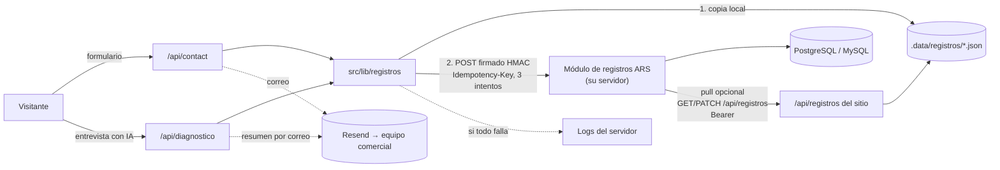

# Registros del sitio → módulo de ARS

**Para:** equipo del servidor de ARS (ERP / plataforma).
**Qué es:** el contrato para que cada lead del sitio web quede guardado en el ERP: los mensajes de **«Contáctenos»** y los **diagnósticos con IA** de `/diagnostico` (perfil de la empresa, conversación, adjuntos y reporte).
**Versión del contrato:** `2`. El sitio la manda en la cabecera `X-ARS-Version` y en el campo `version`.
La versión 2 (5-nov-2026) suma el tipo `propuesta` (§4.4); `contacto` y `diagnostico` no cambian.

Código del sitio: `src/lib/registros/` (módulo), `src/app/api/contact/route.ts`, `src/app/api/diagnostico/route.ts` y `src/app/api/registros/**` (API pull).

---

## 1. Resumen

| | |
|---|---|
| **Push** (principal) | El sitio hace `POST` de cada registro nuevo a una URL que **ustedes exponen**. El cuerpo va firmado con HMAC-SHA256 y lleva `Idempotency-Key`. |
| **Pull** (complementario) | El ERP puede leer y actualizar los registros con `GET/PATCH /api/registros` del sitio, con un token Bearer. Solo sirve donde el sitio tiene disco persistente (ver §2.2). |
| **Respaldo** | Si su servidor no responde, el sitio guarda el registro en un JSON local marcado `pendiente` y lo reenvía después: solo, cada 5 min (`REGISTROS_REINTENTO_MS`), y a pedido con `POST /api/registros/reintentar`. |
| **Tipos de registro** | `contacto` (id `CONT-2026-XXXXXX`), `diagnostico` (id `DIAG-2026-XXXXXX`) y `propuesta` (id `PROP-2026-XXXXXX`, la «Propuesta ARS» de la sección `#contacto`). |

Lo que necesitamos de ustedes:

1. Un endpoint HTTPS `POST` que reciba el JSON (§3).
2. Un **token** (Bearer) y un **secreto** HMAC, generados por ustedes y compartidos por un canal seguro (no por correo ni chat).
3. Dos tablas (§5) o el equivalente en su modelo.

---

## 2. Arquitectura



### 2.1 Qué pasa en cada envío

1. El sitio valida el formulario o termina el diagnóstico y **genera el id** del registro (`DIAG-2026-M4X9PA`). Ese id se le devuelve al usuario y se muestra en el reporte.
2. Si `REGISTROS_COPIA_LOCAL=siempre` (por defecto), escribe la copia local con `sincronizacion.remoto = "pendiente"`.
3. Hace `POST` a su endpoint. Espera hasta `ARS_REGISTROS_TIMEOUT_MS` (8 s) por intento, con **3 intentos en total** (1 + 2 reintentos, esperas de ~0,5 s y ~2 s). Reintenta ante errores de red, timeouts, `408`, `429` y `5xx`. **No** reintenta otros `4xx`.
4. Actualiza la copia local a `enviado` o la deja en `pendiente` con el último error.
5. Si no se pudo guardar en ningún lado, el registro completo va al log del servidor (`[registros] REGISTRO NO GUARDADO …`) para recuperarlo a mano. Si el push está apagado (faltan las variables) y `NODE_ENV=production`, el registro completo también va al log (`[registros] PUSH APAGADO, registro solo en la copia local …`), porque la copia local sola no es durable donde el disco es efímero.
6. Mientras el servidor esté arriba, cada `REGISTROS_REINTENTO_MS` (5 min) reenvía solo lo `pendiente` que tenga más de 1 minuto (lo más reciente lo sigue enviando su propia petición). Si su servidor no responde, la pasada se corta y sigue en la siguiente. Lo que su servidor rechazó de forma definitiva (4xx salvo 408/429) no se reenvía solo: queda `pendiente` con el error para revisarlo y mandarlo con `POST /api/registros/reintentar`. Lo arranca `src/instrumentation.ts` y solo corre si el push está configurado.

La respuesta al usuario espera como mucho `REGISTROS_ESPERA_MS` (2,5 s) a la primera confirmación, sea la copia local o su servidor. Los reintentos siguen en segundo plano con `after()` de Next.js. En la respuesta, `registro.guardado: true` significa que el registro quedó guardado en algún lado.

### 2.2 Dónde corre el sitio y por qué el push es lo principal

El sitio se despliega en **Vercel** (funciones serverless). Ahí el disco del proyecto es de solo lectura y efímero: **la copia local no persiste** entre ejecuciones ni se comparte entre instancias. Por eso:

- **En Vercel** el guardado real es el **push a su servidor**. La API pull no ve los registros de otras instancias. Si su servidor está caído más de ~3 s, el registro solo queda en el log (§2.1 paso 5).
- **En un servidor propio** (Docker, `output: "standalone"`, VM), la copia local sí persiste si se monta un volumen en `REGISTROS_DIR`. Ahí también funcionan la API pull y los reintentos.

**Opcional, más adelante:** si quieren un respaldo durable dentro de Vercel, se puede agregar un adaptador de **Vercel Blob privado** (`@vercel/blob`) que implemente la misma interfaz `AlmacenRegistros` (`src/lib/registros/almacen.ts`). Hoy no está instalado porque el push cubre el caso principal.

---

## 3. Endpoint que debe exponer ARS

```
POST https://<su-servidor>/api/registros-web      (la ruta la eligen ustedes)
```

### 3.1 Cabeceras que envía el sitio

| Cabecera | Ejemplo | Uso |
|---|---|---|
| `Authorization` | `Bearer 3f9c…` | Token compartido (`ARS_REGISTROS_TOKEN`). |
| `Content-Type` | `application/json; charset=utf-8` | |
| `X-ARS-Firma` | `sha256=8a1f…e4` | HMAC-SHA256 en hex de `` `${timestamp}.${cuerpo}` `` con el secreto (`ARS_REGISTROS_SECRET`). |
| `X-ARS-Timestamp` | `1793849102` | Segundos Unix al firmar. Rechacen si difiere más de **5 minutos** de su reloj (anti-replay). |
| `X-ARS-Version` | `2` | Versión del contrato. |
| `Idempotency-Key` | `DIAG-2026-M4X9PA` | Es el id del registro. Es el mismo en todos los reintentos. |
| `User-Agent` | `ARS-Landing-Registros/1` | |

### 3.2 Cuerpo

```json
{
  "evento": "registro.creado",
  "version": 1,
  "enviado": "2026-11-05T03:25:02.481Z",
  "registro": { "...": "RegistroContacto o RegistroDiagnostico (§4)" }
}
```

### 3.3 Cómo verificar

1. Lean el **cuerpo crudo** (bytes exactos) **antes** de parsear el JSON. Si lo re-serializan, la firma no coincide.
2. Comparen el Bearer con su token en **tiempo constante**.
3. Validen `X-ARS-Timestamp` (±300 s).
4. Calculen `"sha256=" + hex(HMAC_SHA256(secreto, timestamp + "." + cuerpo))` y compárenlo en tiempo constante con `X-ARS-Firma`.
5. Comprueben que `registro.id == Idempotency-Key`.
6. Guarden con **upsert por id**: si el id ya existe, respondan `200` o `409` sin duplicar.

### 3.4 Respuestas esperadas

| Código | Cuándo | Qué hace el sitio |
|---|---|---|
| `200` / `201` / `202` | Guardado (o encolado de forma durable). Cuerpo sugerido: `{"ok":true,"id":"DIAG-2026-M4X9PA"}` | Marca `enviado`. |
| `409` | Ya existía ese `Idempotency-Key` | Lo toma como **éxito**. |
| `400` / `422` | Cuerpo inválido | **No** reintenta; queda `pendiente` con el error. Revisen el log. |
| `401` / `403` | Token, firma o timestamp inválidos | **No** reintenta. Es un error de configuración. |
| `408` / `429` / `5xx` / timeout | Problema temporal | Reintenta 2 veces y luego deja `pendiente` para el reenvío manual. |

Respondan **rápido** (< 2 s): guarden y procesen lo pesado en segundo plano. El timeout del sitio es de 8 s por intento.

### 3.5 Ejemplo de verificación — Node.js (Express)

```js
import express from "express";
import { createHmac, timingSafeEqual } from "node:crypto";

const TOKEN = process.env.ARS_REGISTROS_TOKEN;
const SECRETO = process.env.ARS_REGISTROS_SECRET;
const iguales = (a, b) => {
  const A = Buffer.from(a), B = Buffer.from(b);
  return A.length === B.length && timingSafeEqual(A, B);
};

const app = express();
// Cuerpo CRUDO: la firma se calcula sobre los bytes exactos.
app.post("/api/registros-web", express.raw({ type: "application/json", limit: "1mb" }), async (req, res) => {
  const cuerpo = req.body.toString("utf8");
  if (!iguales(req.get("authorization") ?? "", `Bearer ${TOKEN}`)) return res.status(401).json({ ok: false, error: "token" });

  const ts = req.get("x-ars-timestamp") ?? "";
  if (!/^\d+$/.test(ts) || Math.abs(Date.now() / 1000 - Number(ts)) > 300) return res.status(401).json({ ok: false, error: "timestamp" });

  const esperada = "sha256=" + createHmac("sha256", SECRETO).update(`${ts}.${cuerpo}`).digest("hex");
  if (!iguales(req.get("x-ars-firma") ?? "", esperada)) return res.status(401).json({ ok: false, error: "firma" });

  const evento = JSON.parse(cuerpo);
  const r = evento.registro;
  if (r?.id !== req.get("idempotency-key")) return res.status(422).json({ ok: false, error: "id" });

  const nuevo = await guardarRegistro(r); // upsert por id → false si ya existía
  return res.status(nuevo ? 201 : 409).json({ ok: true, id: r.id });
});
```

### 3.6 Ejemplo de verificación — PHP

```php
<?php
$token   = getenv('ARS_REGISTROS_TOKEN');
$secreto = getenv('ARS_REGISTROS_SECRET');
$cuerpo  = file_get_contents('php://input');            // cuerpo CRUDO
$h = array_change_key_case(getallheaders(), CASE_LOWER);

function responder(int $s, array $o) { http_response_code($s); header('Content-Type: application/json'); echo json_encode($o); exit; }

if (!hash_equals("Bearer $token", $h['authorization'] ?? '')) responder(401, ['ok' => false, 'error' => 'token']);
$ts = $h['x-ars-timestamp'] ?? '';
if (!ctype_digit($ts) || abs(time() - (int)$ts) > 300) responder(401, ['ok' => false, 'error' => 'timestamp']);
$esperada = 'sha256=' . hash_hmac('sha256', $ts . '.' . $cuerpo, $secreto);
if (!hash_equals($esperada, $h['x-ars-firma'] ?? '')) responder(401, ['ok' => false, 'error' => 'firma']);

$evento = json_decode($cuerpo, true, 512, JSON_THROW_ON_ERROR);
$r = $evento['registro'];
if (($r['id'] ?? null) !== ($h['idempotency-key'] ?? '')) responder(422, ['ok' => false, 'error' => 'id']);

// INSERT ... ON DUPLICATE KEY UPDATE / ON CONFLICT DO NOTHING (ver §5)
$nuevo = guardar_registro($r);
responder($nuevo ? 201 : 409, ['ok' => true, 'id' => $r['id']]);
```

### 3.7 Ejemplo de verificación — Python (FastAPI)

```python
import hmac, hashlib, json, os, time
from fastapi import FastAPI, Request, Response

TOKEN = os.environ["ARS_REGISTROS_TOKEN"]
SECRETO = os.environ["ARS_REGISTROS_SECRET"].encode()
app = FastAPI()

@app.post("/api/registros-web")
async def recibir(req: Request):
    cuerpo = await req.body()  # bytes CRUDOS
    h = req.headers
    if not hmac.compare_digest(h.get("authorization", ""), f"Bearer {TOKEN}"):
        return Response('{"ok":false,"error":"token"}', 401, media_type="application/json")
    ts = h.get("x-ars-timestamp", "")
    if not ts.isdigit() or abs(time.time() - int(ts)) > 300:
        return Response('{"ok":false,"error":"timestamp"}', 401, media_type="application/json")
    esperada = "sha256=" + hmac.new(SECRETO, ts.encode() + b"." + cuerpo, hashlib.sha256).hexdigest()
    if not hmac.compare_digest(h.get("x-ars-firma", ""), esperada):
        return Response('{"ok":false,"error":"firma"}', 401, media_type="application/json")
    r = json.loads(cuerpo)["registro"]
    if r.get("id") != h.get("idempotency-key"):
        return Response('{"ok":false,"error":"id"}', 422, media_type="application/json")
    nuevo = guardar_registro(r)  # upsert por id
    return Response(json.dumps({"ok": True, "id": r["id"]}), 201 if nuevo else 409, media_type="application/json")
```

### 3.8 Probar la firma sin el sitio

```bash
CUERPO='{"evento":"registro.creado","version":1,"enviado":"2026-11-05T00:00:00Z","registro":{"id":"CONT-2026-TEST01","tipo":"contacto"}}'
TS=$(date +%s)
FIRMA="sha256=$(printf '%s' "$TS.$CUERPO" | openssl dgst -sha256 -hmac "$ARS_REGISTROS_SECRET" -hex | sed 's/^.* //')"
curl -i -X POST "https://<su-servidor>/api/registros-web" \
  -H "Authorization: Bearer $ARS_REGISTROS_TOKEN" -H "Content-Type: application/json" \
  -H "X-ARS-Timestamp: $TS" -H "X-ARS-Firma: $FIRMA" -H "Idempotency-Key: CONT-2026-TEST01" \
  --data-binary "$CUERPO"
```

---

## 4. Esquema de los registros

Los tipos de referencia (TypeScript) están en `src/lib/registros/tipos.ts` y `src/data/diagnostico/tipos.ts`. Todas las fechas son ISO 8601 en UTC. Los campos opcionales pueden faltar o venir en `null`.

### 4.1 Campos comunes

| Campo | Tipo | Notas |
|---|---|---|
| `id` | string | `^(CONT\|DIAG\|PROP)-\d{4}-[0-9A-HJKMNP-TV-Z]{6}$`. Lleva el año UTC de creación y 6 caracteres Crockford base32 aleatorios. Es la clave primaria. |
| `tipo` | `"contacto"` \| `"diagnostico"` \| `"propuesta"` | Cuadra con el prefijo del id. |
| `version` | `2` | Los registros anteriores al 5-nov-2026 llevan `1`. |
| `creado`, `actualizado` | ISO 8601 | |
| `estado` | `nuevo` \| `contactado` \| `en-propuesta` \| `ganado` \| `perdido` \| `descartado` | Siempre llega como `nuevo`. Después lo maneja el ERP. |
| `historialEstados` | `[{estado, fecha, nota?}]` | |
| `origen.pagina` | string \| null | Ruta (`/diagnostico`, `/contacto`…). Sale del cliente o del `Referer`. |
| `origen.sitio` | string \| null | Host que recibió la petición. |
| `origen.ipHash` | string (32 hex) | SHA-256 de `REGISTROS_SAL_IP:IP`, truncado. **La IP nunca se guarda en claro.** Sirve para detectar duplicados o abuso. |
| `origen.userAgent` | string \| null | |
| `origen.entorno` | `production` \| `preview` \| `development` | Filtren `preview`/`development` si no los quieren en el ERP. |

### 4.2 `RegistroContacto`

| Campo | Tipo |
|---|---|
| `contacto.nombre` | string (2–120) |
| `contacto.email` | string (email) |
| `contacto.empresa` | string \| null |
| `contacto.telefono` | string \| null |
| `mensaje` | string (5–5000) |

```json
{
  "id": "CONT-2026-1X5ZP4",
  "tipo": "contacto",
  "version": 1,
  "creado": "2026-11-05T03:25:01.788Z",
  "actualizado": "2026-11-05T03:25:01.788Z",
  "estado": "nuevo",
  "historialEstados": [{ "estado": "nuevo", "fecha": "2026-11-05T03:25:01.788Z" }],
  "origen": {
    "pagina": "/contacto",
    "sitio": "ars-intelligence.com",
    "ipHash": "c35ce363f81234b146523be04d93de37",
    "userAgent": "Mozilla/5.0 (Windows NT 10.0; Win64; x64) …",
    "entorno": "production"
  },
  "contacto": {
    "nombre": "Laura Gómez",
    "email": "laura@andina.co",
    "empresa": "Seguridad Andina",
    "telefono": "3001234567"
  },
  "mensaje": "Quiero una demo del centro de operaciones"
}
```

### 4.3 `RegistroDiagnostico`

| Campo | Tipo | Notas |
|---|---|---|
| `fuente` | `"ia"` \| `"demo"` | `demo` = simulado sin IA (pruebas). **No lo traten como lead real** salvo que el entorno sea `production` y quieran revisarlo. |
| `empresa` | string | Atajo de `perfil.nombre`. |
| `contacto` | `{nombre?, cargo?, email?, telefono?}` \| null | Persona que hizo la entrevista, si dejó sus datos **y aceptó la autorización**. Sin autorización llega `null` (y `perfil` sin `contacto`). |
| `autorizacion` | `{texto, version, fecha}` \| null | Evidencia de la autorización de datos (Ley 1581 de 2012) que aceptó la persona antes del análisis: el texto exacto de esa versión (lo pone el servidor, no el navegador), la versión (`2026-11-05`) y la fecha ISO. `null` si siguió sin dejar sus datos. Campo nuevo y opcional dentro de la versión 1 del contrato: guárdenlo tal cual en el JSON. |
| `perfil` | `PerfilEmpresa` | `nombre`, `sector`, `tamano` (`1-50` \| `51-200` \| `201-1000` \| `1000+`), `ciudad?`, `sedes?`, `personal?`, `dolores[]`, `herramientasActuales[]`, `prioridades[]`, `servicios?[]`, `incidentes?[]`, `plazo?`, `presupuesto?`, `notas?`, `contacto?` |
| `conversacion` | `[{rol: "user"\|"assistant", texto}]` | Hasta 40 turnos, 1500 caracteres cada uno. |
| `adjuntos` | `[{id, nombre, tipo, resumen, hallazgos[]}]` | `tipo`: `imagen` \| `video` \| `documento` \| `audio`. **Solo metadatos y lo que entendió la IA: el archivo no se guarda ni se envía.** |
| `resumen` | `{titular, madurezHoy, madurezConArs, areasRecomendadas[], prioridadAlta[]}` | Para listados y tableros sin tener que abrir el diagnóstico. |
| `diagnostico` | `Diagnostico` | Reporte completo: `titular`, `resumen`, `madurez{hoy,conArs}`, `hallazgos[]`, `recomendaciones[]` (área, módulos, prioridad), `metricas[]` (antes/después, **estimadas**), `fases[]`, `capitulos[]` (historia 3D), `reporteDiario`. Guárdenlo como JSON. |

Ids de área (`areaId`): `operacion-en-campo`, `centro-de-operaciones`, `comunicacion-y-emergencias`, `monitoreo-inteligente`, `realidad-virtual`, `gestion-humana`, `formacion`, `finanzas-y-erp`, `productividad-e-ia`, `gobierno-y-seguridad`.

Ejemplo real (generado en modo demo; las listas de `diagnostico` se recortaron a un elemento para que quepa aquí):

```json
{
  "id": "DIAG-2026-JMF99Y",
  "tipo": "diagnostico",
  "version": 1,
  "creado": "2026-11-05T03:25:02.472Z",
  "actualizado": "2026-11-05T03:25:02.472Z",
  "estado": "nuevo",
  "historialEstados": [{ "estado": "nuevo", "fecha": "2026-11-05T03:25:02.472Z" }],
  "origen": {
    "pagina": "/diagnostico",
    "sitio": "ars-intelligence.com",
    "ipHash": "c35ce363f81234b146523be04d93de37",
    "userAgent": "Mozilla/5.0 …",
    "entorno": "production"
  },
  "fuente": "demo",
  "empresa": "Seguridad Andina",
  "contacto": { "nombre": "Laura Gómez", "cargo": "Gerente", "email": "laura@andina.co" },
  "perfil": {
    "nombre": "Seguridad Andina",
    "sector": "Vigilancia privada",
    "ciudad": "Medellín",
    "tamano": "201-1000",
    "sedes": 40,
    "dolores": ["Rondas sin evidencia"],
    "herramientasActuales": ["Excel", "WhatsApp"],
    "prioridades": ["control"],
    "contacto": { "nombre": "Laura Gómez", "cargo": "Gerente", "email": "laura@andina.co" }
  },
  "conversacion": [
    { "rol": "assistant", "texto": "¿Cómo se llama tu empresa?" },
    { "rol": "user", "texto": "Seguridad Andina, vigilancia en Medellín" }
  ],
  "adjuntos": [
    { "id": "a1", "nombre": "minuta.pdf", "tipo": "documento", "resumen": "Minuta de turnos", "hallazgos": ["Turnos de 12h"] }
  ],
  "resumen": {
    "titular": "De apagar incendios a operar con datos: 40 sedes bajo un mismo tablero",
    "madurezHoy": 34,
    "madurezConArs": 82,
    "areasRecomendadas": ["operacion-en-campo", "centro-de-operaciones", "comunicacion-y-emergencias", "gestion-humana", "finanzas-y-erp", "productividad-e-ia"],
    "prioridadAlta": ["operacion-en-campo", "centro-de-operaciones", "comunicacion-y-emergencias"]
  },
  "diagnostico": {
    "id": "diag-mw2zftzc-t2ehr",
    "fecha": "2026-11-05T03:25:02.472Z",
    "fuente": "demo",
    "titular": "De apagar incendios a operar con datos: 40 sedes bajo un mismo tablero",
    "resumen": "Seguridad Andina creció rápido y su operación sigue en Excel, WhatsApp y radio análoga. …",
    "madurez": { "hoy": 34, "conArs": 82 },
    "hallazgos": [
      {
        "titulo": "Rondas sin evidencia",
        "hoy": "El supervisor confía en llamadas y en el libro de minuta para saber si se hicieron las rondas.",
        "impacto": "Riesgo de perder contratos cuando un cliente reclama y no hay prueba.",
        "areas": ["operacion-en-campo", "centro-de-operaciones"]
      }
    ],
    "recomendaciones": [
      {
        "areaId": "operacion-en-campo",
        "modulos": ["control-de-asistencia-y-relevos", "rondas-qr", "turnos-y-programacion"],
        "prioridad": "alta",
        "porque": "Su mayor dolor es no tener prueba de lo que pasa en el puesto.",
        "cambio": "Cada vigilante marca con selfie y rostro y cada ronda queda con hora y punto QR."
      }
    ],
    "metricas": [
      { "nombre": "Rondas verificadas", "unidad": "%", "antes": 40, "despues": 96, "menosEsMejor": false, "areaId": "operacion-en-campo" }
    ],
    "fases": [
      {
        "nombre": "Fase 1 · Control del campo",
        "semanas": "Semanas 1–4",
        "areas": ["operacion-en-campo", "comunicacion-y-emergencias"],
        "entregables": ["Marcación con rostro en las 40 sedes", "Rondas QR", "Radio PTT y botón de pánico"]
      }
    ],
    "capitulos": [
      {
        "titulo": "Un lunes cualquiera",
        "narracion": "Son las 6 de la mañana en Seguridad Andina. …",
        "momento": "antes",
        "foco": null,
        "activas": []
      }
    ],
    "reporteDiario": {
      "titulo": "Resumen del martes · Seguridad Andina",
      "hora": "6:00 a. m.",
      "items": [{ "etiqueta": "Rondas cumplidas", "valor": "96 %", "tendencia": "sube", "bueno": true }],
      "destacados": ["Botón de pánico en Sede Centro a las 2:14 a. m., atendido en 4 min."]
    },
    "perfil": { "nombre": "Seguridad Andina", "sector": "Vigilancia privada", "tamano": "201-1000", "dolores": [], "herramientasActuales": [], "prioridades": [] }
  }
}
```

Tamaño típico: un contacto pesa ~1 KB; un diagnóstico, entre 15 y 60 KB. El sitio limita la petición de diagnóstico a 150 KB.

---

### 4.4 `RegistroPropuesta`

La «Propuesta ARS» (sección `#contacto` de la home): la persona cuenta cómo opera, la IA le hace 2–3 preguntas de
seguimiento, le arma una propuesta y la persona la envía a un asesor (`POST /api/propuesta/enviar`). El registro se
crea **al enviarla**; para enviarla tiene que aceptar la autorización de datos, así que `contacto` siempre viene.
El mismo envío manda el correo al asesor con el PDF (si hay `RESEND_API_KEY`); el PDF y las vistas 3D **no** van en el
registro.

| Campo | Tipo | Notas |
|---|---|---|
| `referencia` | string | La referencia comercial que la persona ve en su PDF (p. ej. `ARS-2611-7K3Q`). Conviene poder buscar por ella. |
| `empresa` | string | |
| `ciudad` | string \| null | |
| `contacto` | `{nombre, cargo \| null, email, telefono \| null}` | Los datos de la persona van **solo aquí**: no se repiten en `respuestas` ni en `propuesta`. |
| `autorizacion` | `{texto, version, fecha}` \| null | Evidencia de la autorización Ley 1581 (el texto que aceptó). |
| `respuestas` | objeto | Lo que respondió de su operación: `vigilantes` (`1-50 \| 51-200 \| 201-1000 \| 1000+`), `sedes`, `servicios[]`, `central` (`si \| no \| en-proyecto`), `aplicaciones[]`, `erp`, `datos[]`, `integraciones` (texto libre), `dolores[]`, `reportes[]`, `plazo`, `notas` (texto libre). |
| `seguimiento` | `[{id, pregunta, respuesta}]` | Preguntas de la IA y lo que contestó (texto libre). |
| `resumen` | `{titular, areas[], modulos[], plazo \| null, fases}` | Para listados. `areas` son ids; `modulos` son nombres legibles. |
| `propuesta` | objeto | La propuesta tal como la vio: `id`, `fecha`, `empresa`, `situacion`, `titular`, `arsSuple[]`, `seQueda[]`, `modulos[{area, modulo, porQue}]`, `lineaDeTrabajo[{nombre, duracion, objetivo, entregables[], modulos[]}]`, `integraciones[{sistema, modo, detalle}]`, `reportes[{nombre, para, frecuencia, contenido}]`, `impacto[{indicador, hoy, conArs}]`, `siguientesPasos[]`, `analiticas?[]`, `indicadores?[]`, `estrategiaErp?`, `escenario?`, `aviso`. Áreas y módulos van por id. |
| `nombres` | `{areas: {id: nombre}, modulos: {id: nombre}}` | Nombres legibles de los ids que usa `propuesta`. |
| `entrega` | `{pdf: boolean, vistas3d: number}` | Lo que recibió el asesor por correo. |

Para anonimizar (habeas data): además de `contacto.*`, el texto libre puede nombrar a la persona: `respuestas.notas`,
`respuestas.integraciones`, cada `seguimiento[].respuesta` y `propuesta.situacion` (lo redacta la IA con lo que contó).

Tamaño típico: 8 a 25 KB.

## 5. SQL sugerido

Las columnas planas sirven para buscar y filtrar. El registro completo va en `datos` (JSON), que es la fuente de verdad. Así, si el contrato suma campos (`version` 2), no se pierde nada.

### 5.1 PostgreSQL

```sql
CREATE TYPE estado_registro AS ENUM ('nuevo','contactado','en-propuesta','ganado','perdido','descartado');

CREATE TABLE registros_web (
  id              varchar(20)  PRIMARY KEY,               -- CONT-2026-XXXXXX / DIAG-2026-XXXXXX / PROP-2026-XXXXXX
  tipo            varchar(12)  NOT NULL CHECK (tipo IN ('contacto','diagnostico','propuesta')),
  version         smallint     NOT NULL,
  creado          timestamptz  NOT NULL,
  recibido        timestamptz  NOT NULL DEFAULT now(),
  estado          estado_registro NOT NULL DEFAULT 'nuevo',
  entorno         varchar(16)  NOT NULL,
  pagina          varchar(200),
  ip_hash         char(32),
  -- Contacto (de contacto.* en ambos tipos)
  nombre          varchar(120),
  email           varchar(200),
  telefono        varchar(40),
  empresa         varchar(200),
  -- Solo diagnóstico
  fuente          varchar(8)   CHECK (fuente IN ('ia','demo')),
  sector          varchar(120),
  tamano          varchar(10),
  ciudad          varchar(120),
  titular         text,
  madurez_hoy     smallint,
  madurez_con_ars smallint,
  areas_recomendadas text[],
  -- Registro completo tal cual llegó
  datos           jsonb        NOT NULL
);

CREATE INDEX registros_web_tipo_creado ON registros_web (tipo, creado DESC);
CREATE INDEX registros_web_estado      ON registros_web (estado) WHERE estado <> 'descartado';
CREATE INDEX registros_web_email       ON registros_web (lower(email));

CREATE TABLE registros_web_estados (
  id          bigserial    PRIMARY KEY,
  registro_id varchar(20)  NOT NULL REFERENCES registros_web(id) ON DELETE CASCADE,
  estado      estado_registro NOT NULL,
  nota        text,
  usuario     varchar(120),                               -- quién lo cambió en el ERP
  fecha       timestamptz  NOT NULL DEFAULT now()
);

-- Upsert idempotente (devuelve fila solo si era nuevo → 201; si no, 409)
INSERT INTO registros_web (id, tipo, version, creado, entorno, pagina, ip_hash, nombre, email, telefono, empresa,
                           fuente, sector, tamano, ciudad, titular, madurez_hoy, madurez_con_ars, areas_recomendadas, datos)
VALUES ($1, $2, $3, $4, $5, $6, $7, $8, $9, $10, $11, $12, $13, $14, $15, $16, $17, $18, $19, $20)
ON CONFLICT (id) DO NOTHING
RETURNING id;
```

### 5.2 MySQL 8

```sql
CREATE TABLE registros_web (
  id              VARCHAR(20)  NOT NULL PRIMARY KEY,
  tipo            ENUM('contacto','diagnostico','propuesta') NOT NULL,
  version         SMALLINT     NOT NULL,
  creado          DATETIME(3)  NOT NULL,                  -- guarden en UTC
  recibido        DATETIME(3)  NOT NULL DEFAULT CURRENT_TIMESTAMP(3),
  estado          ENUM('nuevo','contactado','en-propuesta','ganado','perdido','descartado') NOT NULL DEFAULT 'nuevo',
  entorno         VARCHAR(16)  NOT NULL,
  pagina          VARCHAR(200) NULL,
  ip_hash         CHAR(32)     NULL,
  nombre          VARCHAR(120) NULL,
  email           VARCHAR(200) NULL,
  telefono        VARCHAR(40)  NULL,
  empresa         VARCHAR(200) NULL,
  fuente          ENUM('ia','demo') NULL,
  sector          VARCHAR(120) NULL,
  tamano          VARCHAR(10)  NULL,
  ciudad          VARCHAR(120) NULL,
  titular         TEXT         NULL,
  madurez_hoy     SMALLINT     NULL,
  madurez_con_ars SMALLINT     NULL,
  areas_recomendadas JSON      NULL,
  datos           JSON         NOT NULL,
  KEY idx_tipo_creado (tipo, creado),
  KEY idx_estado (estado),
  KEY idx_email (email)
) ENGINE=InnoDB DEFAULT CHARSET=utf8mb4 COLLATE=utf8mb4_unicode_ci;

CREATE TABLE registros_web_estados (
  id          BIGINT UNSIGNED AUTO_INCREMENT PRIMARY KEY,
  registro_id VARCHAR(20)  NOT NULL,
  estado      ENUM('nuevo','contactado','en-propuesta','ganado','perdido','descartado') NOT NULL,
  nota        TEXT NULL,
  usuario     VARCHAR(120) NULL,
  fecha       DATETIME(3)  NOT NULL DEFAULT CURRENT_TIMESTAMP(3),
  CONSTRAINT fk_registro FOREIGN KEY (registro_id) REFERENCES registros_web(id) ON DELETE CASCADE
) ENGINE=InnoDB DEFAULT CHARSET=utf8mb4 COLLATE=utf8mb4_unicode_ci;

-- Idempotente: affected_rows = 1 → nuevo (201); 0 → ya existía (409)
INSERT IGNORE INTO registros_web (id, tipo, version, creado, entorno, pagina, ip_hash, nombre, email, telefono, empresa,
  fuente, sector, tamano, ciudad, titular, madurez_hoy, madurez_con_ars, areas_recomendadas, datos)
VALUES (?, ?, ?, ?, ?, ?, ?, ?, ?, ?, ?, ?, ?, ?, ?, ?, ?, ?, ?, ?);
```

Mapeo de columnas desde `registro`:

| Columna | Contacto | Diagnóstico |
|---|---|---|
| `nombre`, `email`, `telefono` | `contacto.*` | `contacto.*` (puede ser null) |
| `empresa` | `contacto.empresa` | `empresa` |
| `fuente`, `sector`, `tamano`, `ciudad` | — | `fuente`, `perfil.sector`, `perfil.tamano`, `perfil.ciudad` |
| `titular`, `madurez_*`, `areas_recomendadas` | — | `resumen.*` |
| `creado` | `creado` (convertir de ISO a UTC) | ídem |

---

## 6. API pull del sitio (opcional)

El ERP puede leer y actualizar los registros del **almacén local** del sitio. Solo tiene sentido donde el sitio tiene disco persistente (§2.2). Todas las rutas exigen `Authorization: Bearer $REGISTROS_API_TOKEN`. Sin el token configurado, responden `503`. Con un token incorrecto, `401`.

| Método y ruta | Qué hace |
|---|---|
| `GET /api/registros` | Lista paginada, del más nuevo al más viejo. Filtros: `tipo` (`contacto`\|`diagnostico`), `estado`, `desde` e `hasta` (ISO 8601; `desde` incluido, `hasta` excluido), `pagina` (desde 1), `limite` (1–200, por defecto 50), `completo=1` (registros completos en vez de resumen). |
| `GET /api/registros/:id` | Registro completo, con `sincronizacion` (`enviado`\|`pendiente`\|`no-configurado`). |
| `PATCH /api/registros/:id` | Cuerpo `{"estado":"contactado","nota":"…"}`. Cambia el estado y lo suma a `historialEstados`. |
| `POST /api/registros/reintentar` | Reenvía a su endpoint los registros `pendiente` (hasta 50 por llamada). Respuesta: `{revisados, enviados[], fallidos[]}`. |

```bash
SITIO=https://ars-intelligence.com
TOKEN=...   # REGISTROS_API_TOKEN

# Sin token → 401
curl -i "$SITIO/api/registros"

# Diagnósticos nuevos desde el 1 de noviembre
curl -s -H "Authorization: Bearer $TOKEN" \
  "$SITIO/api/registros?tipo=diagnostico&estado=nuevo&desde=2026-11-01T00:00:00Z&limite=20"
# → {"ok":true,"total":1,"pagina":1,"limite":20,"paginas":1,"registros":[{"id":"DIAG-2026-JMF99Y","tipo":"diagnostico",
#    "estado":"nuevo","empresa":"Seguridad Andina","email":"laura@andina.co","titular":"…","sincronizacion":"enviado",…}]}

# Uno completo
curl -s -H "Authorization: Bearer $TOKEN" "$SITIO/api/registros/DIAG-2026-JMF99Y"

# Marcar como contactado
curl -s -X PATCH -H "Authorization: Bearer $TOKEN" -H "Content-Type: application/json" \
  -d '{"estado":"contactado","nota":"Llamada agendada"}' "$SITIO/api/registros/CONT-2026-1X5ZP4"

# Reenviar pendientes (p. ej. con un cron cada 15 min mientras su servidor se recupera)
curl -s -X POST -H "Authorization: Bearer $TOKEN" "$SITIO/api/registros/reintentar"
```

El cambio de estado por `PATCH` vive solo en el sitio: **no** se reenvía a ARS. Si el ERP es la fuente de verdad del estado (lo recomendado), no usen `PATCH`; manejen el estado en su tabla.

---

## 7. Seguridad y datos personales

### 7.1 Transporte y credenciales

- Solo **HTTPS** con certificado válido. El sitio no desactiva la verificación TLS.
- Usen **token y secreto distintos**, de 32 bytes aleatorios o más (`openssl rand -hex 32`). El token autentica y el secreto firma. Si se filtra el token, la firma sigue protegiendo la integridad del cuerpo.
- `REGISTROS_API_TOKEN` (pull) es **otro** token, distinto de los dos anteriores.
- Para **rotar**, acepten durante el cambio el secreto viejo y el nuevo (prueben ambas firmas), cambien la variable en Vercel, redesplieguen y retiren el viejo.
- Si pueden, restrinjan además por IP o WAF. Las IP de salida de Vercel no son fijas, así que la firma es el control principal.
- No registren en logs el cuerpo completo ni las cabeceras `Authorization` o `X-ARS-Firma`.

### 7.2 Ley 1581 de 2012 (habeas data, Colombia) y Decreto 1377 de 2013

Los registros traen **datos personales**: nombre, correo, teléfono y cargo, más lo que la persona cuente en la conversación (que puede incluir datos de terceros, como incidentes o nombres de empleados). ARS actúa como **responsable del tratamiento**.

- **Autorización:** el formulario y la entrevista deben mostrar el aviso de privacidad y la finalidad (contactar al interesado y preparar una propuesta comercial) antes de enviar. Si el ERP guarda la evidencia de la autorización, conviene agregar en una versión futura un campo `autorizacion {texto, version, fecha}`. Avísennos y lo sumamos al contrato.
- **Finalidad limitada:** usen los datos solo para gestionar el lead. No para otras bases ni para venderlos o cederlos.
- **Derechos del titular** (conocer, actualizar, rectificar, suprimir, revocar): el ERP debe poder **buscar por email** y **borrar o anonimizar** un registro (`datos`, `nombre`, `email`, `telefono` y los textos de `conversacion`). Respondan las consultas en 10 días hábiles y los reclamos en 15.
- **Seguridad:** acceso por roles en el ERP, cifrado en reposo de la base y de los backups, y auditoría de quién consulta y quién exporta.
- **RNBD:** si ARS está obligada a inscribir sus bases en el Registro Nacional de Bases de Datos de la SIC, esta base de leads es una base más que se debe reportar.
- **Transferencia internacional:** Vercel y los proveedores de IA procesan en el exterior. Debe estar contemplado en la política de tratamiento de datos de ARS.

### 7.3 Retención sugerida

| Dato | Retención |
|---|---|
| Leads sin respuesta o `descartado`/`perdido` | 24 meses desde el último contacto; después, anonimizar. |
| Leads `ganado` | Mientras dure la relación contractual, más el plazo legal de los documentos comerciales. |
| `fuente = demo` o `entorno ≠ production` | Borrar a los 30 días (son pruebas). |
| Copia local del sitio (`.data/registros`) | Es temporal: borrar lo `enviado` con más de 30 días. |

---

## 8. Variables de entorno del sitio

Se configuran en Vercel (Project → Settings → Environment Variables) o en `.env.local`. Todas son **solo de servidor**.

| Variable | Obligatoria | Por defecto | Para qué |
|---|---|---|---|
| `ARS_REGISTROS_URL` | Para el push | — | URL completa del endpoint de §3. |
| `ARS_REGISTROS_TOKEN` | Para el push | — | Bearer que valida su servidor. |
| `ARS_REGISTROS_SECRET` | Para el push | — | Secreto HMAC. **Las tres variables deben ir juntas**: si falta una, el push se desactiva y se avisa en el log. |
| `ARS_REGISTROS_TIMEOUT_MS` | No | `8000` | Timeout por intento (1000–30000). |
| `REGISTROS_DIR` | No | `.data/registros` | Carpeta de la copia local (en Docker, móntenla como volumen). |
| `REGISTROS_COPIA_LOCAL` | No | `siempre` | `siempre` = copia local aunque el push funcione; `respaldo` = solo si el push falla. |
| `REGISTROS_ESPERA_MS` | No | `2500` | Cuánto espera la respuesta al usuario a la confirmación (0–15000). |
| `REGISTROS_REINTENTO_MS` | No | `300000` | Reintento de fondo de lo `pendiente` (mín. 30000; `0` = apagado). |
| `REGISTROS_ENTORNO` | No | `VERCEL_ENV` o `NODE_ENV` | `production`, `preview` o `development` en `origen.entorno`. Para que las pruebas no se cuelen como leads reales. |
| `REGISTROS_API_TOKEN` | Para la API pull | — | Bearer de `/api/registros`. Sin ella, la API responde 503. |
| `REGISTROS_SAL_IP` | No | `ARS_REGISTROS_SECRET` | Sal del hash de la IP. |
| `RESEND_API_KEY`, `CONTACT_TO`, `RESEND_FROM` | Ya existían | | El aviso por correo de contacto y diagnóstico se sigue enviando aunque el registro se guarde. |

---

## 9. Checklist de puesta en marcha

**Equipo del servidor de ARS**

- [ ] Crear las tablas (§5) en la base del ERP.
- [ ] Exponer `POST /api/registros-web` (o la ruta que elijan) por HTTPS.
- [ ] Generar el token y el secreto (`openssl rand -hex 32`, uno cada uno) y guardarlos en el gestor de secretos.
- [ ] Implementar la verificación (§3.3): Bearer, timestamp ±300 s, HMAC sobre el cuerpo crudo y `id == Idempotency-Key`.
- [ ] Upsert idempotente: `201` si es nuevo, `409` si ya existía. Responder en menos de 2 s.
- [ ] Probar con el `curl` de §3.8: firma válida → 201, firma alterada → 401, mismo id dos veces → 409.
- [ ] Pantalla o vista en el ERP para los leads, filtrable por `tipo`, `estado` y `fuente` (ocultar `demo` por defecto).
- [ ] Búsqueda por email, y borrado o anonimización (habeas data, §7.2).
- [ ] Alerta si deja de llegar tráfico o si suben los 4xx o 5xx.

**Equipo del sitio**

- [ ] Recibir por un canal seguro la URL, el token y el secreto.
- [ ] `vercel env add ARS_REGISTROS_URL production` (y lo mismo con `_TOKEN` y `_SECRET`; también en `preview` si quieren recibir las pruebas, idealmente apuntando a un endpoint de pruebas).
- [ ] Opcional: `REGISTROS_API_TOKEN` si van a usar la API pull o el reintento.
- [ ] Redesplegar y enviar un contacto de prueba desde el sitio. Verificar que llegó al ERP con el mismo `CONT-…`.
- [ ] Hacer un diagnóstico de prueba. Verificar que el ERP tiene el `DIAG-…` que muestra la respuesta (`registro.id`).
- [ ] Revisar en Vercel → Logs que no aparezcan `[registros] Push a ARS falló` ni `REGISTRO NO GUARDADO`.
- [ ] Confirmar que el aviso de privacidad del formulario y de la entrevista cubre esta finalidad.

### Prueba local de punta a punta

```bash
# .env.local del sitio
ARS_REGISTROS_URL=http://localhost:4599/registros
ARS_REGISTROS_TOKEN=token-prueba-ars
ARS_REGISTROS_SECRET=secreto-prueba-ars
REGISTROS_API_TOKEN=token-pull-prueba
```

Levanten un receptor mínimo con el código de §3.5 en el puerto 4599 (o el que trae el repo, sin dependencias:
`ARS_REGISTROS_TOKEN=… ARS_REGISTROS_SECRET=… node scripts/receptor-registros-prueba.mjs 4599`, que además muestra lo
recibido en `GET http://localhost:4599/recibidos`) y ejecuten `npm run dev`. Después:

```bash
curl -s -X POST http://localhost:3000/api/contact -H "Content-Type: application/json" \
  -d '{"name":"Prueba","email":"prueba@ars.co","message":"Hola, quiero una demo"}'
# → {"ok":true,"registro":{"id":"CONT-2026-…","guardado":true}}  y el receptor responde 201
ls .data/registros/
```
