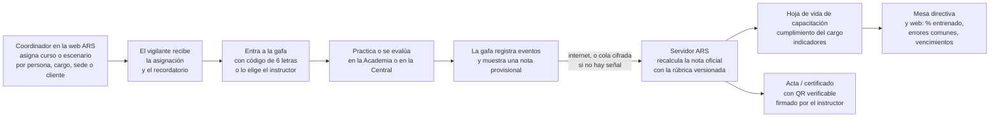

# ARS · Sala de realidad virtual — explicación completa, con foco en la capacitación de vigilantes

**Fecha:** 5 de noviembre de 2026 · **App:** «ARS» 0.2.0 para Meta Quest · **Para:** el equipo de la página web
(ARS_Landing / `app.ars-intelligence.com`) y para Daniel.

**Qué contiene:**
1. Contexto general de la Sala VR. Ya está en la web; se resume para no perder el hilo.
2. **La capacitación en VR, explicada a fondo:** la Academia ARS, sus cuatro módulos, cómo se califica y los
   personajes con IA.
3. **La conexión con la plataforma ARS:** cómo entra el vigilante, cómo viaja el resultado, qué ve el coordinador en
   la web y cómo se certifica.
4. Qué está construido de verdad y qué falta, para no prometer de más.
5. **Textos listos para la sección «Capacitación» de la web.**

> **Fuentes:** el repositorio de la gafa (`C:\vigias\sala-vr-quest`, rama `main` en `bd1eb66e`), en especial
> `kit/docs/academia/00…09`, `kit/docs/CONTEXTO-SERVIDOR-CAPACITACION-VR.md`, `kit/docs/f5/SALA-VR-ARS-PARA-WEB.md`,
> `kit/docs/API-RV.md` y las entregas de los frentes de la Academia (`kit/docs/entregas/academia-*.md`,
> `f5-portal-academia.md`).

---

## Parte 1 · Contexto general (lo que ya está en la web)

### 1.1 Qué es

**ARS Sala VR** es la experiencia de realidad virtual de ARS Intelligence para Meta Quest. En pocos minutos el
visitante se pone las gafas y **ve por dentro cómo funciona una empresa de seguridad que trabaja con ARS**. La guía
**Aria** lo acompaña. No necesita saber de realidad virtual: el mundo cambia a su alrededor y él solo mira, toca y decide.

**Regla de marca:** ARS Intelligence es una empresa de **tecnología** que vende su plataforma a empresas de seguridad
privada. Las empresas que aparecen son ficticias y se presentan como clientes de ARS: *Seguridad Andina* y *Custodia
Norte*, con sus clientes *Torre Calima*, *Conjunto Arrayanes* y *Bodega Siberia*. En la escuela, el uniforme y los
instructores son **de la empresa de seguridad**; ARS pone la herramienta.

### 1.2 Dónde funciona

| Gafa | Experiencia |
|---|---|
| Meta Quest 3 / 3S | Calidad alta (90 Hz) y opción de realidad mixta |
| Meta Quest 2 | Calidad base (72 Hz), 100 % virtual |

- Hay una sola app, «ARS». Se maneja con **mandos o con las manos** (agarrar, tocar, señalar con rayo).
- **Modo demo / feria:** arranca sin internet y sin usuario, con datos simulados, y avanza solo.
- **Con sesión real:** se entra con el usuario de ARS.

### 1.3 El recorrido

| Experiencia | Promesa | En una línea |
|---|---|---|
| **Vestíbulo** | — | Lobby ARS. Aria da la bienvenida y desde aquí salen los portales |
| **Central de monitoreo** | «Ninguna alerta se queda sin dueño.» | La alerta llega con evidencia, la operadora Laura la toma, despacha por radio y la cierra |
| **Su empresa, por dentro** | «Del contrato a la nómina, del puesto a la Central: una sola plataforma.» | Una maqueta viva de la empresa que el visitante manipula: despacha, cubre turnos y ve llegar la nómina |
| **La sede del cliente** | «La seguridad la hacen personas. ARS hace que cada paso quede probado.» | Un día y una noche en Torre Calima: portería, relevo, ronda, alerta, revista e informe al cliente |
| **Mesa directiva** | — | Indicadores por área. El acta termina en «Mis tareas» |
| **Academia ARS** (nueva) | «Aquí se forma a la gente que cuida. Y cada certificado se puede comprobar.» | **Esta es la sección que falta en la web: se explica en la Parte 2** |

---

## Parte 2 · La capacitación en realidad virtual

### 2.1 La idea en una frase

**Academia ARS** es el módulo de capacitación de la plataforma ARS en realidad virtual. El vigilante se pone las gafas,
entra a la escuela de su empresa y **aprende haciendo**:
- se viste y revisa su dotación;
- maneja el arma con seguridad en el polígono;
- decide desde su garita si puede o no usar la fuerza;
- vive un turno completo atendiendo gente.

Mientras tanto, **la plataforma lo califica** y lleva el resultado a su hoja de vida de capacitación en el ARS.

**Por qué importa (el argumento de venta):**
- **Hay cosas que no se pueden practicar en la vida real sin riesgo:** un atraco en la entrada, un borracho
  agresivo en la reja, un paquete que gotea, la decisión de desenfundar o no. En VR se practican cien veces, sin
  peligro y con un instructor que explica el porqué.
- **Todo queda medido:** cuánto tardó en reportar a la central, si habló con respeto, si el dedo estuvo fuera del
  gatillo, si dejó entrar a quien no debía.
- **Encaja con lo que el ARS ya hace en capacitación** (cursos, evaluaciones, certificados con QR y auditoría de
  quién debe qué curso). La VR es una actividad más dentro de esos cursos, no un sistema paralelo.

### 2.2 Para quién

| Persona | Qué entrena o hace |
|---|---|
| **Vigilante / guarda** | Dotación, revista y relevo, manejo seguro del arma, uso de la fuerza, control de acceso, servicio, minuta, rondas |
| **Supervisor** | Revista de puestos, respuesta a novedades, cobertura |
| **Operador de central** | Atender alertas de video y de pánico de punta a punta: radio, minuta, escalamiento |
| **Coordinador / jefe de capacitación** | No se pone las gafas: **asigna, ve resultados y certifica desde la web del ARS** |
| **Instructor** | Dirige la sesión en el salón, elige quién se pone la gafa, revisa el repaso y firma el acta |

Cada empresa de seguridad cliente es una **organización** del ARS: sus vigilantes, sus resultados y sus certificados
quedan aislados de las demás, como en el resto de la plataforma.

### 2.3 Cómo se entra: el portal

En el vestíbulo hay un **portal**: un remolino verde de energía de 2,2 m que gira y late. **A través del remolino se ve
el destino:** el patio de formación, con cadetes trotando y el instructor **Óscar**, que saluda cuando el visitante lo
mira. Antes de verlo se oye: el silbato, las órdenes, los pasos en formación. Al tocarlo o atravesarlo, el remolino
envuelve al visitante, hay un destello verde y aparece en la Academia, con el portal de vuelta detrás.

Dentro, el **patio de formación** funciona como centro: tiene las puertas a cada actividad (aula, polígono, garita,
portería) y el **tablero del curso**, con el avance y los módulos bloqueados. Siempre hay **Repetir**, **Pausa** (congela
el escenario y los personajes), **Salir al patio** y la salida al vestíbulo.

### 2.4 El curso: «Academia ARS · Vigilante»

```
Curso «Academia ARS · Vigilante»   (ciclo: fundamentación | reentrenamiento | especialización)
 ├─ Módulo 1  Inducción y dotación        → actividad calificada: revista y relevo
 ├─ Módulo 2  Manejo seguro y polígono    → lecciones P1 a P10
 ├─ Módulo 3  Uso de la fuerza            → 12 escenarios × 4 niveles de dificultad
 └─ Módulo 4  Turno en la portería        → turno de día o de noche, 3 tipos de puesto, 4 niveles
```

- **Orden:** primero el Módulo 1. Después el 2 y el 3, en cualquier orden. El Módulo 4 se abre al final.
- **Ciclos** (los de la Resolución 4973 de 2011): *fundamentación* (el que empieza), *reentrenamiento* (el anual) y
  *especialización*. En especialización el vigilante elige su contexto: **residencial** (conjunto), **comercial**
  (calle o local) o **industrial** (fábrica o bodega), y la Academia le da prioridad a esos escenarios.
- **El administrador de la empresa en el ARS** asigna módulos, niveles mínimos y fechas límite.

**Notas mínimas por defecto** (tomadas de la Res. 4973, art. 45; cada empresa las puede ajustar):

| Módulo | Área de la norma | Nota mínima |
|---|---|---|
| M1 Inducción | Procedimientos de seguridad privada | 80 |
| M2 Polígono | Armamento y tiro | 70 (fundamentación) · 75 (reentrenamiento) · 80 (especialización) |
| M3 Uso de la fuerza | Legal + procedimientos | 80, y **cero faltas graves** en los escenarios obligatorios |
| M4 Turno | Procedimientos + socio-humanística | 80 |

---

### 2.5 Módulo 1 · «Su puesto, su dotación» (inducción y revista)

**Lugar:** el aula-vestier de la escuela. **Guía:** Óscar, el instructor jefe.

| Estación | Qué hace el vigilante |
|---|---|
| **Bienvenida** (60 s) | Óscar presenta la escuela y las reglas |
| **«Vístase»** | Se pone **cada elemento de la dotación** en su lugar: uniforme (distinto al de la Policía y sin grados), gorra, **credencial de Supervigilancia** (vigente un año), carné de la empresa, radio con batería, linterna, pito, bastón si el puesto lo tiene, libreta y bolígrafo, y celular con los números de la central, el supervisor, el cuadrante, el 123, bomberos y Cruz Roja |
| **La mesa del puesto** | Revisa la dotación del puesto |
| **«¿Puede o no puede?»** | 12 tarjetas rápidas. Por ejemplo: pedir y registrar el documento (puede), retener la cédula (no puede), requisar la maleta (no puede), perseguir a un ladrón fuera del puesto (no puede: informa y protege el puesto), disparar al aire (no puede), informar un delito (puede y **debe**), entregar un paquete a un niño (no puede), dar el apartamento de un residente a un desconocido (no puede) |
| **Medio canino** (opcional) | Wilmer, el guía canino, y su perro Zeus enseñan el bienestar del animal, el mando y sus límites |
| **Actividad calificada: «Revista y relevo»** (5–6 min) | Le pasa revista a un compañero y **recibe el puesto** en el relevo: novedades, equipo y minuta |

### 2.6 Módulo 2 · Polígono: manejo seguro del arma y tiro defensivo

**Lugar:** un polígono cubierto con 6 carriles de 25 m, cabina del instructor y semáforo. Las armas son de
entrenamiento, genéricas y sin marca: **revólver .38** de 6 tiros, **escopeta de bomba** calibre 12 y un **revólver
azul de práctica** que no dispara (sirve para practicar en seco).

**Realismo de la interacción:** el tambor bascula, los cartuchos se meten uno por uno o con el **cargador rápido**, la
varilla expulsa los casquillos, el martillo se monta con el pulgar y la bomba de la escopeta corre. El gatillo distingue
entre **dedo apoyado y dedo apretando**: con mandos, por el sensor de toque; con manos, por la curvatura del índice. El
retroceso mueve el arma y el mando vibra, pero **la cámara no se mueve**, así no marea.

**El «guardián» de seguridad vigila todo el tiempo:**

| Infracción | Consecuencia |
|---|---|
| Cañón hacia una persona (el instructor, otro carril o el propio cuerpo) | Vibración y «¡Cañón al frente!». La 2.ª vez, alto de línea. La 3.ª, sale de la línea y repite las 4 reglas |
| Dedo en el gatillo sin estar en posición de tiro | «¡Dedo fuera!», −5 en seguridad |
| Arma cargada fuera de la línea de fuego | Alto de línea, −15 |
| Disparar con semáforo rojo o después de «¡Alto el fuego!» | −25 y sale de la línea |
| Dejar el arma cargada en la mesa | −10 y «¡Muestre vacío!» |
| Sin protección de oídos y ojos | La línea no se abre |

**Las 10 lecciones:**

| # | Lección | Lo que se aprende |
|---|---|---|
| P1 | Las cuatro reglas | Las reglas de seguridad, repetidas en voz alta |
| P2 | Recibir el arma | Abrir, **verificar vacío** mirando y tocando, cañón a zona segura, firmar el libro |
| P3 | Cargar y descargar | Revólver (a mano y con cargador rápido) y escopeta; contar cartuchos; mostrar vacío. Primero guiado, luego contra reloj |
| P4 | Postura y empuñadura | Postura isósceles. La app mide el ángulo de las muñecas, la separación de las manos y la altura |
| P5 | Miras y respiración | Alinear mira trasera, delantera y blanco |
| P6 | Control del gatillo | Fuego en seco con una moneda sobre el cañón: si el cañón se mueve más de 1° antes del «clic», la moneda cae |
| P7 | Tiro de precisión | Series a 3, 7, 10 y 15 m con tiempo, y una serie con escopeta |
| P8 | Tiro de reacción | Blancos que aparecen |
| P9 | Disparar / no disparar | Decidir en milésimas si el blanco es una amenaza o no |
| P10 | Cierre de línea | Descargar, mostrar vacío, entregar el arma y los cartuchos sobrantes, firmar |

**Calificación del polígono (100 puntos):** seguridad 30 (empieza en 100 y se descuenta), manejo 20, precisión 25,
reacción y decisión 25. **La seguridad pesa tanto como la puntería:** no es un juego de disparos.

**Lo que mide el tiro:** agrupación, sesgo de los impactos, estabilidad, «jalón» del gatillo y anticipación del
retroceso. Con eso el instructor le dice al alumno *por qué* falla, no solo *que* falla.

### 2.7 Módulo 3 · «¿Puede o no puede?»: el uso de la fuerza desde la garita

**La idea que tiene que quedar:** el vigilante está para **prevenir, reportar y proteger la vida**. Casi siempre
gana el escenario **sin desenfundar**. Ningún escenario premia disparar para proteger bienes.

**Lo que puede hacer el vigilante dentro del escenario:** hablar (lo escucha la IA), llamar por radio a la central,
marcar el 123 en el celular de la garita, usar el citófono, abrir o cerrar la puerta y la talanquera, revisar y marcar
las cámaras, escribir la minuta en la tableta ARS, cubrirse detrás del muro, usar la linterna, el bastón y, solo si de
verdad toca, desenfundar, empuñar, apuntar y disparar. Cada uno de esos pasos queda registrado con su hora.

**Los 12 escenarios** (3 contextos × 4):

| Contexto | Escenarios |
|---|---|
| **A · Calle** (garita de un comercio sobre una avenida) | A1 «El celular» (hurto en moto frente a la garita) · A2 «La persona en la entrada» (habitante de calle) · A3 «¿Arma o celular?» (ambigüedad) · A4 «La marcha» (manifestación) |
| **B · Conjunto residencial** (portería de torres) | B1 «El exesposo» (un embriagado quiere entrar donde su ex) · B2 «El falso técnico» · B3 «El atraco en la entrada» (armado) · B4 «La pelea del parqueadero» |
| **C · Fábrica / bodega** (garita industrial) | C1 «La lonchera» (hurto hormiga) · C2 «El exempleado» (vuelve de noche) · C3 «La camioneta de la madrugada» (robo de carga) · C4 «El paquete que gotea» (sospechoso) |

**Cuatro niveles de dificultad:**

| Nivel | Qué cambia |
|---|---|
| 1 · Básico | Detonante claro, un solo personaje, pistas del instructor («Piense: ¿esto es una agresión actual?»), más tiempo |
| 2 · Intermedio | Dos personajes, ruido, una distracción (el citófono suena en el peor momento) |
| 3 · Avanzado | Ambigüedad (¿arma o celular?), terceros en la línea de tiro, noche o lluvia, la central demora en responder |
| 4 · Experto | Varias amenazas, información falsa por radio, un residente que exige «¡dispárele!», menos tiempo, y consecuencias que se arrastran al siguiente escenario |

**Calificación (100 puntos, en seis dimensiones):**

| Dimensión | Peso | Qué se mira |
|---|---|---|
| **Legalidad y necesidad** | 30 | ¿Usó la fuerza solo cuando era necesaria? Desenfundar sin necesidad o disparar fuera de la legítima defensa deja esta dimensión en **0 y reprueba el escenario** |
| **Proporcionalidad** | 15 | ¿Subió y bajó de nivel según la conducta del otro? (presencia → palabra → control físico → arma) |
| **Comunicación** | 15 | Tono, claridad, órdenes claras en peligro, si logró calmar a la persona |
| **Reporte** | 20 | **Radio a la central primero**, **123 directo** si hay riesgo para la vida, a tiempo y **completo** (qué pasa, dónde, cuántos, armas, características, hacia dónde huyeron, heridos) y minuta al final |
| **Seguridad propia y de terceros** | 15 | Se cubrió, no salió del puesto, no puso a nadie en la línea de fuego, no persiguió |
| **Evidencia y escena** | 5 | Marcó las cámaras, no movió nada, le entregó la información a la Policía |

Aprueba con **80 o más y ninguna falta grave**. Al terminar hay un **repaso**: la línea de tiempo de lo que hizo, lo
que se esperaba y no hizo, y la explicación de Óscar.

**Ejemplo: B1, «El exesposo».** Llega Edgar, embriagado, a la reja. Lo que el vigilante dice cambia su ánimo:

| Si el vigilante dice… | Edgar responde | Ánimo |
|---|---|---|
| «Buenas noches, don Edgar. Le entiendo, pero no le puedo abrir: la señora no autorizó. ¿Quiere un vaso de agua mientras llamo a alguien que lo recoja?» | «…Usted es buena gente, hermano, pero es que ella…» (baja la voz) | baja 20 |
| «Váyase que está borracho.» | «¿Borracho? ¡Borracho su papá! ¡Ábrame!» (golpea la reja) | sube 25 |
| «Ya llamé a la policía, se va a ir preso.» (como amenaza) | Se altera e intenta trepar la reja | sube 30 |
| (Silencio, mirando el celular) | «¿Me está ignorando? ¡Hey!» | sube 10 |

### 2.8 Módulo 4 · «Un turno en la portería» (el simulador del día del vigilante)

Un **turno de 12 horas comprimido** en pocos minutos. Hay tres puestos, todos ficticios: un conjunto residencial de 4
torres, un edificio de oficinas y una bodega de alimentos.

| Franja | Qué pasa |
|---|---|
| 05:45 Relevo | El vigilante de la noche le entrega el puesto con sus novedades |
| 06:00–08:30 | Salida al trabajo y al colegio, rutas, domicilios, un niño que quiere salir solo |
| 08:30–12:00 | Paquetes, técnicos (uno falso desde el nivel 2), una obra, un adulto mayor, ronda 1 |
| 12:00–14:00 | Pico de domicilios del almuerzo |
| 14:00–17:00 | Visitas, mudanza, el vecino bravo, un abogado que pide datos, la novia sorpresa, ronda 2 |
| 17:00–18:00 | Entrega de paquetes; el supervisor pasa revista y firma la minuta; entrega de turno |

**La gente llega en cola**, con un catálogo de 36 casos que se combinan: residentes, visitas, domicilios, mensajería y
paquetes, servicios, obras y mudanzas, emergencias (un adulto mayor que se cae, un niño perdido, olor a gas, incendio
en el cuarto de basuras) y seguridad (un merodeador, alguien que filma la portería). Hay **hilos narrativos** que
atraviesan el turno, como el de doña Gloria, la residente de 72 años.

**Calificación del turno (100):** control de acceso 30, servicio y trato 25, minuta 20, paquetería 10, tiempos de
atención 10, rondas 5.

### 2.9 Los personajes y la conversación con IA

**Se habla de verdad.** El vigilante le habla en voz alta a la persona que tiene enfrente y esta le responde con voz,
boca sincronizada y gestos. Su **ánimo sube o baja** según cómo la traten.

- **Elenco fijo:** Óscar Bermúdez (instructor jefe, bogotano, suboficial retirado), Yamile Cárdenas (instructora de
  servicio y control de acceso, paisa), Wilmer Mosquera y su perro Zeus (guía canino), Diana (la central, por radio),
  el operador de la línea 123 y Ramiro (el supervisor que llega en moto).
- **Elenco rotativo:** unas 30 personas con nombre, edad, forma de hablar regional, objetivo y secreto. Algunos
  ejemplos: doña Gloria (72, «mijito, qué pena con usted»), el Dr. Zuluaga («¿Usted no sabe quién soy yo?»), Kevin el
  domiciliario barranquillero, el falso técnico «Jhon Fredy», Samuel, un niño perdido de 7 años, y Edgar, el exesposo
  embriagado.
- **Habla colombiana real,** con acentos de Bogotá, Medellín, Cali, Barranquilla, Pasto, Boyacá, Santander, el
  Pacífico y Venezuela (residentes venezolanos).
- **«Guion de oro»** (lo que enseña Yamile): saludar bien, pedir el documento con cortesía, explicar por qué se espera
  y negar el ingreso sin humillar. La IA califica cinco dimensiones del trato: **cortesía, firmeza, claridad, empatía y
  procedimiento**.
- **Control de sesgo:** hay «gemelos de sesgo», casos iguales con personas de distinto origen o aspecto. Por ejemplo,
  Yorman es un residente venezolano legítimo y María José, una domiciliaria venezolana bajo la lluvia. Si el vigilante
  trata distinto a dos personas en la misma situación, queda un informe aparte **para revisión humana** (no es un
  castigo automático).
- **Tres motores de conversación**, con el mismo contrato:
  1. un agente de voz en tiempo real (ElevenLabs), con la llave guardada en el servidor y nunca en la gafa;
  2. una tubería en el servidor de ARS;
  3. un **motor local sin internet**, para la feria y la demo.

### 2.10 Los escenarios operativos (Central y sede): la otra mitad de la capacitación

Además de la Academia, las salas «de negocio» se pueden convertir en **entrenamiento del día a día con la plataforma**.
Esta parte es la propuesta que se le envió al servidor:

| Id | Escenario | Rol | Estado |
|---|---|---|---|
| E1 | Atender una alerta de intrusión detectada por IA de video | Operador de central | **Casi listo** (ya existe el ciclo de alerta; falta el modo evaluación) |
| E2 | Botón de pánico de un guarda: tomar, verificar, radio, minuta, cerrar | Operador / supervisor | Propuesta |
| E3 | Control de acceso: visitante sin cita, documento que no coincide, vehículo no autorizado | Guarda | Propuesta |
| E4 | Conato de incendio: alarma, aviso a la central, extintor correcto (técnica PASS), evacuación | Guarda | Propuesta |
| E5 | Ronda con puntos de control y 3 anomalías escondidas | Guarda / supervisor | Propuesta |
| E6 | Entrega de turno: novedades, minuta y equipo | Guarda | Propuesta |

**Ejemplo de rúbrica (E1):** tomar la alerta (15 puntos; plenos si es en 15 s o menos), **verificar en video antes de
actuar** (20), ubicar en el mapa (10), comunicar por radio en el canal correcto (20), minuta con el tipo y la prioridad
correctos (15), cerrar con resultado (10) y tiempo total (10; pleno si es en 90 s o menos). **Faltas graves:** cerrar
sin verificar, no tomarla en 120 s, cerrar como «falsa alarma» una intrusión real o abandonar la sala con la alerta
abierta.

### 2.11 Tres modos de uso

| Modo | Para qué | ¿Cuenta para el certificado? | ¿Envía datos? |
|---|---|---|---|
| **Práctica** | Aprender, con las ayudas del instructor y la guía | No | Sí, se registra |
| **Evaluación** | Sin ayudas, sin cierre automático, con rúbrica | **Sí**, suma al cumplimiento | Sí |
| **Demo / feria** | Mostrar | No | **Nunca** (todo queda en memoria y se borra con el siguiente visitante) |

### 2.12 La base legal (lo que respalda el contenido)

| Norma | Para qué se usa |
|---|---|
| **Decreto Ley 356 de 1994** (Estatuto de Vigilancia y Seguridad Privada) | Finalidad del servicio (prevenir sin afectar derechos), deberes del vigilante, credencial, armas de la empresa, uniforme. **Prohíbe enseñar tácticas militares u ofensivas** |
| **Resolución 4973 de 2011** (capacitación) | Ciclos, horas mínimas, especializaciones, tiro defensivo (precisión y reacción), notas mínimas y **acta firmada** de las prácticas |
| **Decreto Ley 2535 de 1993** (armas) | Tenencia y porte |
| **Código Penal, art. 32 num. 6** (legítima defensa) | La regla con la que se califica el disparo |
| Uso diferenciado de la fuerza | La escalera presencia → palabra → control → arma |
| **Ley 1581 de 2012** (habeas data) | Por qué el vigilante no da datos de los residentes, y cómo se tratan los datos del propio alumno |

**Lo que la Academia NO enseña:** tácticas ofensivas o de asalto, desarme ni modificación de armas, persecuciones,
retenciones ni requisas corporales. **Nada de sangre:** los impactos son en papel, la persona que cae no sangra y la
escena funde a negro.

> **Importante:** la Academia **complementa** las horas presenciales que exige la norma; **no las reemplaza**. El acta
> de la práctica la firma un instructor humano en el ARS, no la app. Los textos legales los revisa un abogado de la
> empresa antes de mostrarse.

---

## Parte 3 · La conexión con la plataforma ARS (cómo viaja la capacitación)

### 3.1 El viaje completo, de la asignación al certificado



### 3.2 Paso a paso

**1. Asignación (web del ARS).** El coordinador asigna escenarios o módulos por persona, cargo, sede, cliente o grupo,
con fecha límite, intentos máximos y nivel mínimo. Para eso se usa lo que el ARS ya tiene en capacitación: cursos
asignados solos por cargo, sede o puesto, y el **mapa de reglas** (*al ingreso → plan → cargo «Guarda» → curso
obligatorio*). La Academia entra como **una actividad de tipo «VR» dentro de un curso** del módulo de Capacitación
virtual.

**2. Identificación en una gafa compartida.** Una gafa la usan muchas personas. Hay dos formas de entrar, y se
recomiendan las dos:
- **Código de la web** (para uso individual): la persona abre la web del ARS en su celular, ve 6 letras, las escribe
  en la gafa, se entrena y, al terminar, la gafa cierra la sesión sola.
- **Sesión de instructor** (para salones de capacitación): el instructor inicia sesión una sola vez. Para cada
  vigilante elige su nombre en la lista del grupo y le pasa la gafa. Los intentos quedan a nombre del vigilante y se
  registra quién los tomó. Así nadie tiene que teclear en VR y sirve para grupos de 20 guardas.

**3. Durante el escenario.** La gafa registra **eventos de alto nivel** con su hora: «tomó la alerta», «abrió la cámara
3», «llamó a la central», «desenfundó», «escribió la minuta». Al final muestra una **nota provisional** con el repaso.

**4. Envío (con o sin señal).** El intento y sus eventos se guardan en una **cola cifrada en la gafa** y se envían
cuando hay internet. El envío no duplica nada: cada intento tiene un identificador único y cada evento, un número de
orden. Si no hay señal, la nota se muestra como «provisional» y se envía después.

**5. La nota oficial la pone el servidor.** El servidor guarda el catálogo y las rúbricas **con versión**: un intento se
califica siempre con la versión con que se hizo. Con los eventos, el servidor **recalcula la nota**. El motor de la gafa
es determinista (con la misma semilla, el escenario se repite igual), así que el servidor puede reproducir el intento y
comparar. Si las notas no coinciden, manda la del servidor.

**6. Resultado en el ARS.**
- **Para el vigilante:** su avance, sus notas y su certificado.
- **Por vigilante** (lo ven el supervisor y Gestión Humana): avance del curso, notas por módulo, intentos, tiempo en
  simulación, un **radar de fortalezas** (las 5 dimensiones del trato más legalidad, reporte y tiro), los escenarios
  fallados con la corrección, el **repaso** («a los 12 s tomó la alerta, a los 40 s abrió la cámara…») y la
  transcripción, solo si el vigilante la autorizó.
- **Por puesto o cliente:** % de vigilantes certificados, vencimientos del reentrenamiento anual y **los tres errores
  más comunes** (por ejemplo: «no reportan a la central», «dejan entrar técnicos sin orden», «dedo en el gatillo»).
- **Alertas para Gestión Humana:** faltas graves repetidas, posible trato diferenciado (siempre con revisión humana),
  polígono reprobado dos veces.
- **Mesa directiva:** los indicadores alimentan el mismo **cumplimiento de capacitaciones** que ya muestra el ARS. Se
  suman el % de personal entrenado, la nota media por escenario, el tiempo medio de respuesta a alertas y las faltas
  graves del mes.

**7. Certificado.** Al aprobar los cuatro módulos, el ARS emite el **acta digital de práctica en simulación**. Lleva
la fecha, las horas registradas, las notas, la versión del contenido y la **firma del instructor**, que la revisa en el
ARS. Va con un **código QR verificable** que abre la página pública de verificación del ARS, como los demás
certificados de la plataforma. El documento queda en el **expediente** de la persona con su vigencia (vigente, por
vencer o vencido).

### 3.3 Permisos y privacidad

- Es un módulo con permisos como el resto del ARS: leer, crear, editar y borrar. **El vigilante ve solo lo suyo**, el
  coordinador ve su organización y el súper administrador, todo.
- **Por defecto no sale de la gafa:** el audio del micrófono, el video de la cámara, el mapa de la habitación ni el
  seguimiento fino de la mirada o las manos. Solo salen los eventos de alto nivel.
- La transcripción de lo que dijo el vigilante va **aparte**, con consentimiento en pantalla y retención corta
  (Ley 1581). En la feria no se graba nada.
- Las alertas y minutas creadas **durante un entrenamiento no ensucian la operación real**: viven en la simulación y
  quedan marcadas como entrenamiento.
- La gafa nunca lleva llaves de servicios. Solo lleva el token del usuario.

### 3.4 Lo que el servidor tiene que construir (resumen técnico)

Las rutas se unificaron en un solo módulo, `/vr/*`. El prefijo final lo decide el servidor:

| Ruta | Para qué |
|---|---|
| `GET /vr/escenarios`, `GET /vr/escenarios/{id}` | Catálogo con rúbrica y versión (incluye las actividades de la Academia con `modulo=academia`) |
| `GET /vr/asignaciones/mias`, `POST /vr/asignaciones` | Qué le toca a la persona / asignar desde la web |
| `POST /vr/intentos` | Abrir un intento (sin duplicados, por el identificador de la gafa) |
| `POST /vr/intentos/{id}/eventos` | Lote de eventos numerados |
| `POST /vr/intentos/{id}/finalizar` | Cerrar el intento: el servidor devuelve la nota oficial, la retroalimentación y el certificado |
| `GET /vr/intentos?personaId=&escenarioId=&sedeId=…` | Resultados para la web |
| `POST /vr/intentos/{id}/conversacion`, `/turno`, `/transcripciones` | Conversación con IA (URL firmada del agente de voz) y transcripción con consentimiento |
| Código de la web (`/rv/api/gafas/codigo` y `/token`) y cliente Keycloak `rv-quest` | Entrar a la gafa sin teclear la contraseña |
| Alta del curso en Capacitación virtual y reflejo en `learning/compliance/resumen` | Que la VR sume al cumplimiento que ya existe |

El detalle completo, con ejemplos JSON, está en `kit/docs/CONTEXTO-SERVIDOR-CAPACITACION-VR.md` §4–§5 y en
`kit/docs/API-RV.md` («Pendiente del servidor»).

---

## Parte 4 · Estado real (léalo antes de publicar)

| Pieza | Estado al 5-nov-2026 |
|---|---|
| Diseño completo de la Academia (normativa, 4 módulos, personajes, IA, calificación, producción) | ✅ Escrito (10 documentos) |
| Núcleo de la Academia: motor de escenarios, calificación en 6 dimensiones, repaso, modelo de ánimo, cola de intentos sin duplicados | ✅ Construido, con pruebas automáticas en verde |
| Contenido: 12 escenarios (96 rutas probadas), 49 casos del turno, 3 hilos, 60 fichas de personajes, 355 frases de vigilante, 1 205 textos | ✅ Escrito y validado |
| Polígono: revólver y escopeta con todas sus piezas, guardián de seguridad, blancos, estadísticas de tiro | ✅ Construido. Jugables hoy: **P3** (cargar y descargar) y **P7** serie 2; las demás lecciones están diseñadas |
| Portal en el vestíbulo y patio de la Academia | ✅ Construido |
| Recorrido corto de feria (≈ 4 min): bienvenida, tablero de selección, mapa de reglas, aula, polígono, resultado y **certificado con QR** | ✅ Construido. El progreso solo queda en memoria |
| Garita (Módulo 3) y portería (Módulo 4) como escenas jugables | ⏳ Falta construirlas (el contenido ya está) |
| Conversación con IA en tiempo real | ⏳ Diseñada; falta la prueba de concepto en la gafa. El clasificador local acierta 61 % en validación cruzada: necesita frases reales de vigilantes |
| Escenarios operativos E1–E6 | E1 casi listo; E2–E6 en propuesta |
| **Conexión con el servidor (módulo `/vr/*`)** | ❌ **No existe todavía.** Propuesta enviada al servidor |
| Probado con la gafa puesta | ❌ **Todavía no** (rendimiento, voces, comodidad) |
| Modelos 3D definitivos de Óscar y los cadetes | ⏳ Hoy hay sustitutos «provisionales» |

---

## Parte 5 · Textos propuestos para la sección «Capacitación» de la web

### 5.1 Encabezado

> **Academia ARS · Capacitación de vigilantes en realidad virtual**
> Aquí se forma a la gente que cuida. Y cada certificado se puede comprobar.

**Subtítulo:** Su personal practica lo que no se puede practicar en la calle: el atraco en la entrada, el visitante
agresivo, la decisión de desenfundar o no. Sin riesgo, con un instructor que explica el porqué y con cada resultado en
la hoja de vida de capacitación del ARS.

### 5.2 Bloques (cuatro tarjetas, una por módulo)

1. **Su puesto, su dotación.** El vigilante se viste, revisa su dotación y aprende qué puede y qué no puede hacer en
   el puesto. Termina con una revista y un relevo calificados.
2. **Polígono seguro.** Revólver y escopeta de entrenamiento con todas sus piezas. Un guardián de seguridad vigila el
   cañón y el dedo en el gatillo todo el tiempo: aquí la seguridad vale tanto como la puntería.
3. **¿Puede o no puede?** Doce situaciones reales desde la garita (calle, conjunto y fábrica), en cuatro niveles.
   Gana el que previene, reporta y protege la vida, casi siempre sin desenfundar.
4. **Un turno en la portería.** Doce horas en pocos minutos: residentes, domicilios, paquetes, técnicos falsos,
   emergencias y la minuta. Cada persona tiene su nombre, su acento y su genio.

### 5.3 Cómo funciona (tres pasos)

1. **Se asigna desde el ARS.** Por cargo, sede o cliente, con fecha límite. El curso le llega solo a quien lo necesita.
2. **Se practica en las gafas.** Con mandos o con las manos, hablando en voz alta. La persona del otro lado responde y
   cambia de ánimo según el trato.
3. **Se ve y se certifica en el ARS.** Notas, repaso paso a paso, errores más comunes por puesto y un acta con código
   QR que cualquiera puede comprobar.

### 5.4 Frases cortas

- «Lo que no se puede practicar en la calle, se practica aquí.»
- «La seguridad vale tanto como la puntería.»
- «Gana el que previene, reporta y protege la vida.»
- «Se habla de verdad: la persona responde según cómo la trate.»
- «Cada curso llega solo a quien lo necesita.»
- «Cada certificado lleva un código QR. Cualquiera lo puede comprobar.»
- «Basada en la normativa colombiana de vigilancia privada.»

### 5.5 Qué SÍ y qué NO decir

**Sí:**
- Que la Academia está diseñada sobre el Decreto 356/94 y la Resolución 4973/11, y que el enfoque es **defensivo**.
- Que funciona en Meta Quest 3/3S y Quest 2, con mandos o manos, y en demo sin internet.
- Que los certificados del ARS llevan un **QR verificable** (esto ya existe en la plataforma).
- Que el recorrido de demostración se puede vivir hoy en la feria: portal, polígono y certificado.

**No, todavía:**
- Que **la nota de la VR ya llega al ARS**: el módulo del servidor no existe aún. Mientras tanto, se dice «su resultado
  queda registrado» solo en demo, sin decir dónde.
- Que la VR **reemplaza las horas presenciales** o que el acta tiene validez ante Supervigilancia: es práctica
  complementaria y la firma un instructor humano.
- Que los cuatro módulos están completos y jugables (hoy hay polígono parcial y recorrido de feria).
- Que la IA conversa en tiempo real (falta la prueba en la gafa).
- Cifras reales de cumplimiento, de clientes o de mejora.
- Detección de armas por cámara, entrenamiento táctico u ofensivo, o cualquier imagen con sangre.
- Ningún rastro de la marca anterior: la escuela es **de la empresa de seguridad** (ficticia en la demo: «Seguridad
  Andina»).

### 5.6 Material visual

- Capturas del Editor (sirven para maquetar, no son de la gafa): `kit/docs/capturas/academia/`. Ahí están el portal
  visto de frente en calidad alta y en calidad base, el vestíbulo con el portal, la llegada, el tablero, el mapa de
  reglas, el aula y el certificado.
- Pendiente: video real desde la gafa (30 s del portal y del polígono) cuando se haga la prueba en Quest 3.

---

## Parte 6 · Decisiones pendientes de Daniel

1. **Nombre visible:** «Academia ARS» (el propuesto) u otro.
2. Si la Academia se **vende como módulo aparte** del ARS (con su propio permiso, como `RV_QUEST`).
3. Llevar al servidor la **unificación `/vr/*`** y decidir qué entrada se habilita primero: el código de la web, la
   sesión de instructor o las dos.
4. El **revisor legal** y el **instructor de tiro** de la empresa que validan los contenidos.
5. El presupuesto de ElevenLabs para las voces y la conversación de la Academia.
6. Si el QR del certificado de feria lleva una URL pública de verificación (hoy lleva un código de demostración).
7. Organizar la **prueba con 5 vigilantes reales**.
